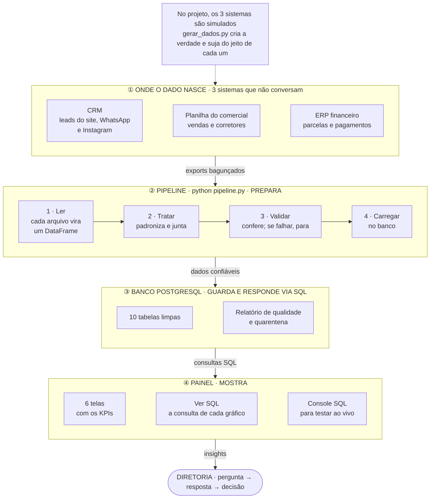

# Painel de Dados ADR

> **Projeto conceitual de candidatura · dados simulados.** Não é material oficial da ADR
> Empreendimentos. Os nomes e fatos públicos dos empreendimentos vêm do site da empresa; todos os
> números são simulados.

Painel de dados **comercial e de recebíveis** pensado para a ADR Empreendimentos, construtora de
compactos de alto padrão em João Pessoa (PB). Ele mostra o que um analista de dados faria lá dentro
para a diretoria: juntar o que vem do CRM, da planilha do comercial e do ERP financeiro, tratar e
validar esses dados num banco PostgreSQL e transformar tudo em respostas claras.

**Status:** em construção. O desenho completo está em [`docs/spec.md`](docs/spec.md).

## Do dado à resposta

## Stack

Python (Pandas, NumPy, Matplotlib) · PostgreSQL rodando no navegador com PGlite · React, Vite e
TypeScript · ECharts · publicação automática no GitHub Pages.

---

Por Cauê Franco.
