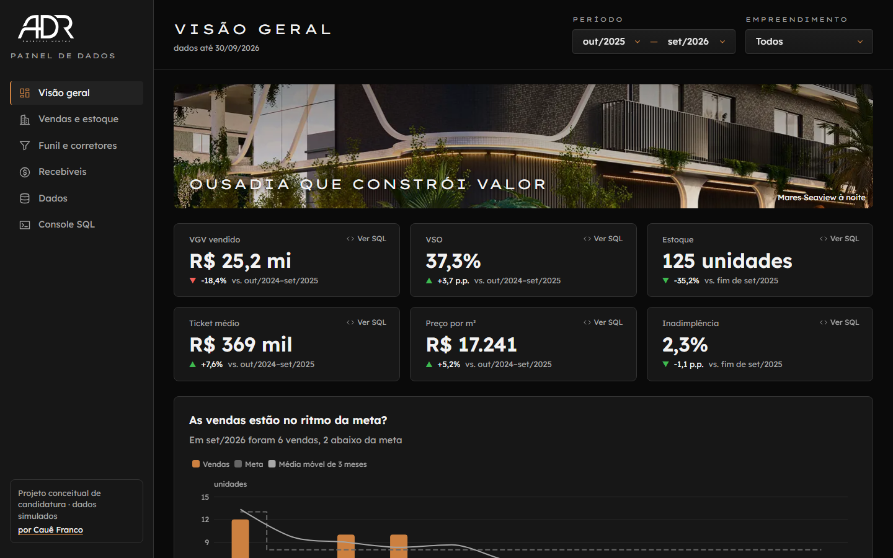
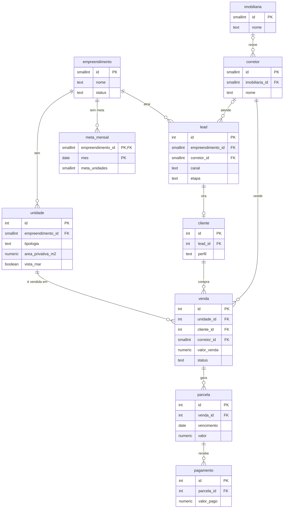
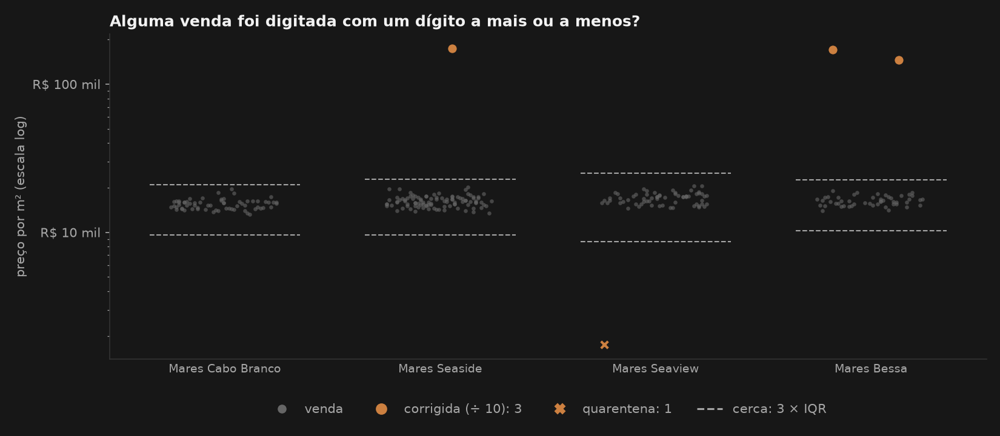
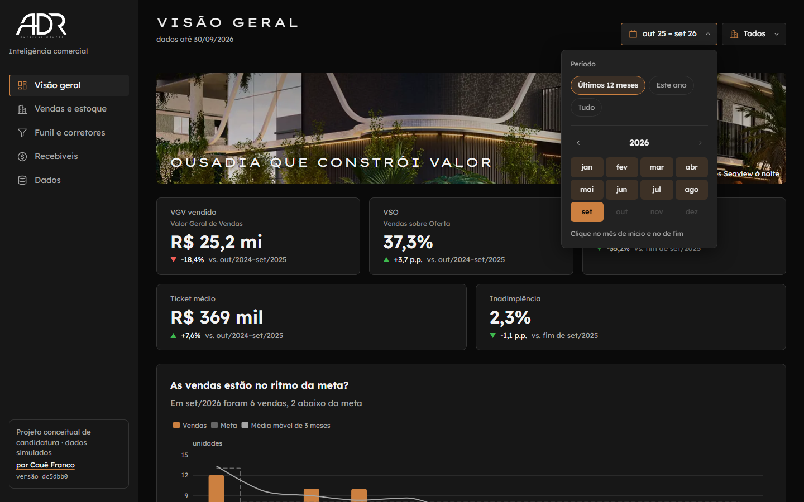
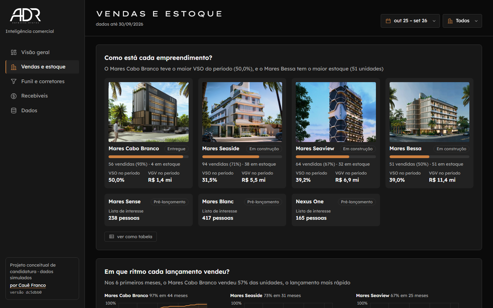
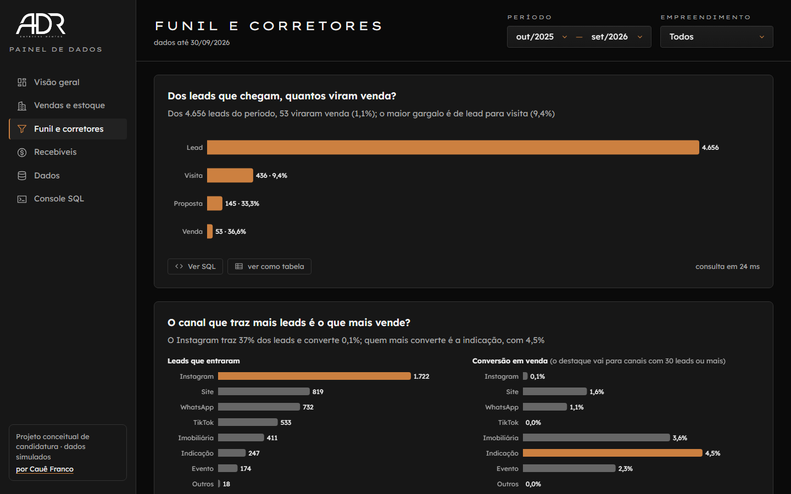
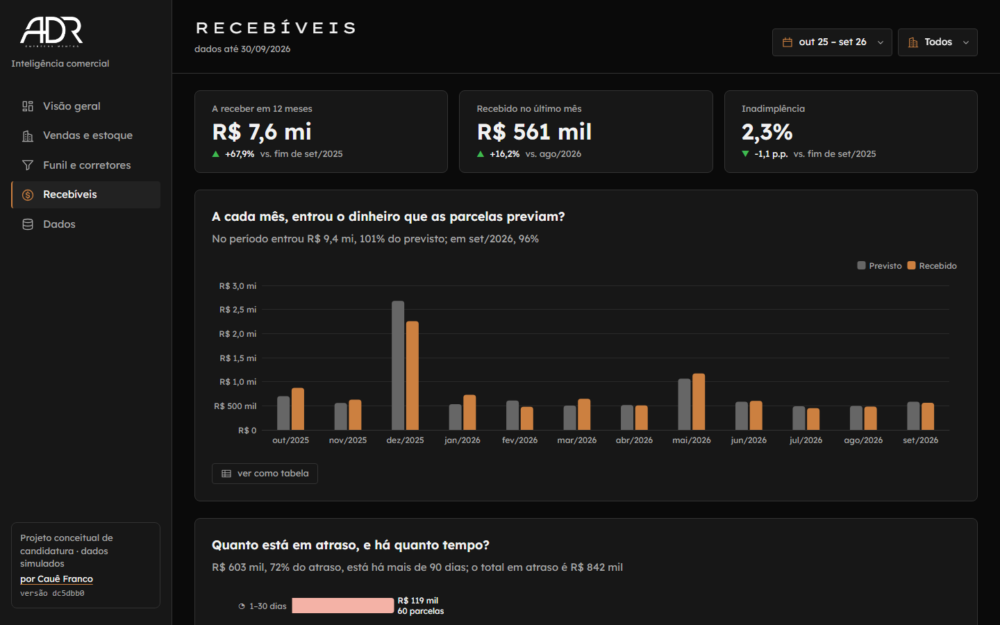
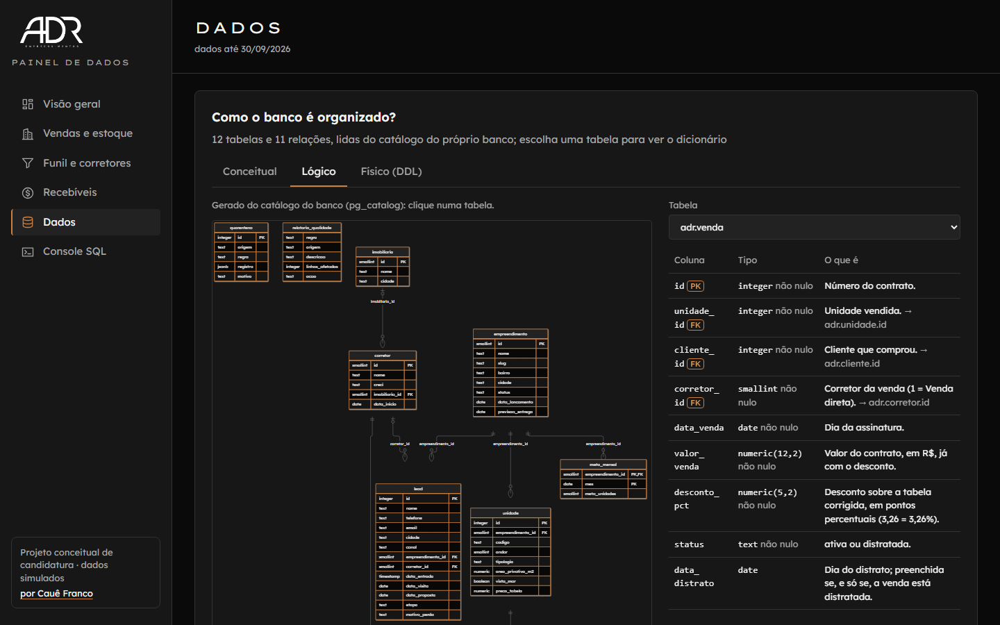

# ADR · Inteligência comercial

[](https://github.com/cauedev30/painel-adr/actions/workflows/ci-e-publicacao.yml)

> **Projeto conceitual de candidatura · dados simulados.** Não é material oficial da ADR
> Empreendimentos. Os nomes e fatos públicos dos empreendimentos vêm do site da empresa; todos os
> números são simulados.

Painel comercial e de recebíveis pensado para a ADR Empreendimentos, construtora de compactos de alto
padrão em João Pessoa (PB), que vende na planta, parcelado, por corretores parceiros. Ele responde às
três perguntas que definem a saúde desse negócio: **o lançamento está vendendo no ritmo certo? De onde
vêm os compradores? O dinheiro das parcelas está entrando?**

Para responder, junta o que vem de três sistemas que não conversam (CRM, planilha do comercial e ERP
financeiro), trata e valida esses dados em Python, guarda tudo num banco PostgreSQL e mostra as
respostas num painel feito para quem decide. O SQL de cada número está em [`sql/consultas/`](sql/consultas).

**Site:** https://cauedev30.github.io/painel-adr/ (o banco roda no navegador; não há nada para instalar)



## Arquitetura

```
                ┌────────────────────────────────────────────────┐
                │ gerar_dados.py                                 │
                │ simula os sistemas, com semente e gabarito     │
                └───────────────────────┬────────────────────────┘
                                        │ cada sistema exporta do seu jeito
         ┌──────────────────┬───────────┴─────────┬────────────────────┐
         ▼                  ▼                     ▼                    ▼
 ┌───────────────┐ ┌─────────────────┐ ┌─────────────────────┐ ┌───────────────┐
 │ CRM           │ │ Planilha do     │ │ ERP financeiro      │ │ Diretoria     │
 │ leads         │ │ comercial       │ │ parcelas e baixas   │ │ metas         │
 │ .csv UTF-8    │ │ vendas, .xlsx   │ │ .csv Latin-1        │ │ .xlsx         │
 └───────┬───────┘ └────────┬────────┘ └──────────┬──────────┘ └───────┬───────┘
         └──────────────────┴───────────┬─────────┴────────────────────┘
                                        │ 6 arquivos brutos (dados/brutos/)
                                        ▼
                ┌────────────────────────────────────────────────┐
                │ pipeline.py · Python e Pandas                  │
                │ ler → tratar (R1 a R7) → validar → carregar    │
                └───────────────────────┬────────────────────────┘
                                        │ tabelas limpas, relatório e quarentena
                                        ▼
                ┌────────────────────────────────────────────────┐
                │ PostgreSQL (PGlite)                            │
                │ schemas adr e auditoria, salvo em banco.tar.gz │
                └───────────────────────┬────────────────────────┘
                                        │ consultas SQL (sql/consultas/)
                                        ▼
                ┌────────────────────────────────────────────────┐
                │ Painel · React e ECharts, no GitHub Pages      │
                │ o banco abre no navegador, num Web Worker      │
                └────────────────────────────────────────────────┘
```

Não há servidor: o pipeline monta o banco uma vez, e o navegador de quem abre o site baixa esse banco e
roda as consultas localmente.

## Stack

### Dados
- Python 3.12, Pandas 3.0 e NumPy 2.5 no pipeline e na geração dos dados
- Faker (pt-BR) para nomes, telefones e e-mails com cara de dado brasileiro
- Matplotlib e Jupyter no [notebook do pipeline](notebooks/tour-do-pipeline.ipynb)
- pytest: cada regra de tratamento é testada contra o gabarito que a geração grava

### Banco
- PostgreSQL rodando em WebAssembly pelo PGlite 0.5.9: o mesmo banco no build (Node) e no navegador
- SQL puro, que roda em qualquer Postgres (psql, pgAdmin, DBeaver)
- `comment on` em toda tabela e coluna: o dicionário de dados mora no próprio banco

### Painel
- React 19, TypeScript 6 e Vite 8
- ECharts 6 nos gráficos de barras e linhas, com um destaque em cobre e o resto em cinza
- Transições leves: a tela entra em cascata e as barras crescem, em qualquer computador
- Vitest 5: cada consulta roda no banco gerado e precisa respeitar invariantes (o funil é decrescente,
  as faixas de atraso somam o vencido em aberto, os padrões plantados aparecem nos dados)

### Publicação
- GitHub Actions: gera os dados, roda o pipeline e todos os testes e só então publica
- GitHub Pages, com navegação por hash (qualquer tela recarrega sem 404)

## Banco de dados

10 tabelas no schema `adr` e 2 no schema `auditoria`, em [`sql/01_schema.sql`](sql/01_schema.sql). O
diagrama mostra as chaves; as colunas e o dicionário estão no próprio schema (`comment on`) e saem da
consulta [`der.sql`](sql/consultas/dados/der.sql), que lê o catálogo do banco.



| Tabela | Para que serve |
|---|---|
| `empreendimento` | Os 7 empreendimentos reais da ADR, com bairro e status do site |
| `unidade` | As 390 unidades dos 4 lançados: tipologia, área, vista mar e preço de tabela |
| `imobiliaria` | Imobiliárias parceiras |
| `corretor` | Corretores; o id 1 é "Venda direta" (a ADR vendeu sem corretor) |
| `lead` | Leads do CRM, já sem duplicatas: canal, corretor, datas e etapa do funil |
| `cliente` | O lead que comprou; um lead vira no máximo um cliente |
| `venda` | Contratos; o distratado continua aqui, com status e data do distrato |
| `parcela` | O plano de pagamento de cada venda (sinal, mensais, balões e chaves) |
| `pagamento` | Baixas do ERP; uma parcela pode ter zero, um ou vários pagamentos (parciais) |
| `meta_mensal` | Meta de unidades por empreendimento e mês, da planilha da diretoria |
| `auditoria.relatorio_qualidade` | O que cada regra do pipeline tratou, e quantas linhas |
| `auditoria.quarentena` | As linhas barradas, inteiras (em `jsonb`), com a regra e o motivo |

Decisões de modelagem:
- O status da unidade (disponível ou vendida) não é guardado: sai da venda ativa. Assim não existem dois
  lugares dizendo coisas diferentes
- Uma unidade só pode ter uma venda ativa, garantido por um índice único parcial
  (`unique (unidade_id) where status = 'ativa'`)
- O distrato não apaga a venda: muda o status e preenche a data, e uma `check` garante que uma coisa
  não existe sem a outra
- Dinheiro em `numeric(12, 2)`, nunca em ponto flutuante; telefone em E.164, conferido por expressão
  regular na própria tabela
- A qualidade dos dados também é consultável por SQL: o schema `auditoria` guarda o relatório e a
  quarentena, e nada some em silêncio
- Duas views fazem as junções que quase toda consulta precisa: `adr.vw_venda` (venda com unidade,
  empreendimento, corretor e preço/m²) e `adr.vw_carteira` (parcela com saldo em aberto, dias de atraso
  e faixa)

## Pipeline

### As fontes e a sujeira

| Arquivo | Sistema | Formato | A sujeira |
|---|---|---|---|
| `crm_leads.csv` | CRM | `;`, UTF-8, datas `dd/mm/aaaa hh:mm` | leads duplicados, telefone em vários formatos, canal digitado à mão, nome de corretor abreviado, um lote com datas em outro formato, e-mail inválido |
| `comercial_espelho.xlsx` | Planilha do comercial | unidades, vendas e distratos digitados à mão | bairro e nome de corretor escritos de vários jeitos, venda sem corretor, valor com um dígito a mais ou a menos, venda antes do lead |
| `comercial_parceiros.xlsx` | Planilha do comercial | corretores e imobiliárias | é o cadastro oficial contra o qual os nomes são casados |
| `erp_parcelas.csv` | ERP financeiro | Latin-1, valor como texto `R$ 1.234,56` | vencimento impossível (2099) |
| `erp_baixas.csv` | ERP financeiro | o mesmo formato | pagamento de parcela que não existe |
| `diretoria_metas.xlsx` | Diretoria | um mês por coluna | vem larga e precisa virar uma linha por mês |

### O caminho do dado

```
┌────────────────────────────────┐
│ 1 · ler                        │
│ 6 arquivos viram 10 tabelas    │
└────────────────────────────────┘
       │ valores do jeito que chegaram
       ▼
┌────────────────────────────────┐            ┌──────────────────────────────┐
│ 2 · tratar                     │ ─ barra ─▶ │ quarentena                   │
│ R1 a R7 e a cascata            │            │ a linha inteira e o motivo   │
└────────────────────────────────┘            └──────────────────────────────┘
       │ tabelas tratadas e o relatório
       ▼
╭────────────────────────────────╮            ┌──────────────────────────────┐
│ 3 · passa nas 10 checagens?    │ ── não ──▶ │ para e não grava nada        │
╰────────────────────────────────╯            └──────────────────────────────┘
       │ sim
       ▼
┌────────────────────────────────┐
│ 4 · carregar                   │
│ CSVs limpos e banco.tar.gz     │
└────────────────────────────────┘
```

### As regras

| Regra | Problema | Tratamento | Nesta base |
|---|---|---|---|
| R1 | A mesma pessoa entrou duas vezes no CRM | telefone padronizado em E.164; mesmo telefone ou e-mail é a mesma pessoa; fica o lead mais antigo, com o andamento mais avançado | 634 leads mesclados |
| R2 | Bairro e nome de corretor escritos de vários jeitos | de-para de bairros; nome casado com o cadastro (igual, inicial + sobrenome, parecido); ambíguo vai para a quarentena | 3 bairros e 243 nomes casados, 3 nomes ambíguos |
| R3 | Canal digitado à mão ("insta", "IG", "Zap") | dicionário de sinônimos; o que ele não conhece vira `outro` e é relatado | 29 jeitos de escrever viram 8 canais |
| R4 | Datas em dois formatos e datas impossíveis | lê os dois formatos; vencimento depois de 2035 ou venda antes do lead vão para a quarentena | 792 datas no outro formato, 6 barradas |
| R5 | Dinheiro em texto e valor digitado com um dígito a mais ou a menos | converte para número; cerca de 3 × IQR do preço/m² por empreendimento; se ÷ 10 volta para a faixa, corrige; senão, quarentena | 3 vendas corrigidas, 1 barrada |
| R6 | Campo vazio ou inválido | venda sem corretor vira "Venda direta"; e-mail inválido vira nulo | 20 vendas, 285 e-mails |
| R7 | Pagamento de parcela que não existe | quarentena, nunca apagado em silêncio | 6 pagamentos |

O que depende de uma linha barrada vai junto (a venda leva as parcelas, a parcela leva os pagamentos),
para o banco não ficar com filho sem pai. Ao todo, 147 linhas vão para a quarentena, e 131 delas por
essa cascata. A quarentena bate, id por id, com o gabarito que a geração gravou.

O [notebook do pipeline](notebooks/tour-do-pipeline.ipynb) percorre cada regra com o antes, o depois e
um gráfico, chamando as mesmas funções de `etl/`:



## Painel

Feito para quem decide: cada cartão é uma pergunta do negócio, com a resposta escrita numa frase logo
abaixo, calculada dos dados.

| Tela | A pergunta | O que tem |
|---|---|---|
| Visão geral | Como está a ADR, numa tela só? | 5 KPIs (VGV, VSO, estoque, ticket médio e inadimplência), cada um contra o período anterior, e as vendas mensais × meta |
| Vendas e estoque | O lançamento está vendendo no ritmo certo? | um cartão por empreendimento (vendido × estoque, VSO e VGV) e o ritmo de vendas de cada lançamento |
| Funil e corretores | De onde vêm os compradores? | o funil com a conversão entre etapas, leads e conversão por canal, e o ranking de corretores |
| Recebíveis | O dinheiro das parcelas está entrando? | previsto × recebido, saldo por faixa de atraso, mapa de calor empreendimento × faixa, e a inadimplência por empreendimento e por desconto |
| Dados | Dá para confiar nesses números? | o que a limpeza fez com cada problema dos arquivos brutos, e o que é real e o que é simulado |

Todo cartão tem **ver como tabela**, com os números por trás do gráfico, e **baixar PDF**; o cabeçalho
tem **Baixar PDF da tela**, um relatório com os KPIs e todos os cartões, na identidade da ADR, pronto
para mandar ao comercial ou ao financeiro. Os filtros ficam em dois
botões no topo: o **período**, com atalhos de um clique ("Últimos 12 meses", "Este ano", "Tudo") e uma
grade de meses para o período exato, e o **empreendimento**. O filtro vai para o endereço da página,
então um link já abre filtrado.



| | |
|---|---|
|  |  |
|  |  |

## Consultas SQL

30 consultas em [`sql/consultas/`](sql/consultas), uma pergunta por arquivo. 19 alimentam o painel, uma
por cartão ou KPI; as outras 11 ficam no repositório como análise. As que filtram recebem os mesmos
parâmetros: `$1` início do período, `$2` fim do período e `$3` empreendimento (nulo = todos).

| Pasta | No painel | Só no repositório | Um exemplo | Arquivo |
|---|---|---|---|---|
| `visao-geral` | 6 | 1 | Quantas unidades a ADR vendeu a cada mês, e isso bateu a meta? | [`vendas_mensais.sql`](sql/consultas/visao-geral/vendas_mensais.sql) |
| `vendas-estoque` | 2 | 3 | Em que ritmo cada lançamento vendeu, mês a mês desde o lançamento? | [`ritmo_acumulado.sql`](sql/consultas/vendas-estoque/ritmo_acumulado.sql) |
| `funil-corretores` | 3 | 0 | Quem são os corretores que mais vendem, e quem subiu ou caiu no ranking? | [`ranking_corretores.sql`](sql/consultas/funil-corretores/ranking_corretores.sql) |
| `recebiveis` | 7 | 1 | Em que empreendimento e em que faixa de atraso o dinheiro está parado? | [`mapa_calor.sql`](sql/consultas/recebiveis/mapa_calor.sql) |
| `dados` | 1 | 1 | Que problemas os arquivos brutos tinham, e o que o pipeline fez com cada um? | [`qualidade.sql`](sql/consultas/dados/qualidade.sql) |
| `console` | 0 | 5 | Como as vendas mensais evoluíram desde o primeiro lançamento, sem o sobe e desce? | [`04_media_movel_vendas.sql`](sql/consultas/console/04_media_movel_vendas.sql) |

As que ficam só no repositório respondem perguntas de análise, como a estatística do preço/m²
([`preco_m2_estatisticas.sql`](sql/consultas/vendas-estoque/preco_m2_estatisticas.sql): média, mediana,
moda, desvio padrão e percentis), o prêmio da vista mar
([`vista_mar.sql`](sql/consultas/vendas-estoque/vista_mar.sql)) e o distrato depois do atraso
([`distratos_e_atraso.sql`](sql/consultas/recebiveis/distratos_e_atraso.sql)). Todas são testadas no
banco gerado, como as do painel.

O conjunto usa de propósito CTEs, `rank()`, `lag()`, `sum() over` (acumulado), `avg() over` (média
móvel), `percentile_cont() within group`, `mode()`, `stddev_samp`, `count(*) filter`, `date_trunc`,
`generate_series` (o mês sem venda aparece com zero) e consulta ao catálogo (`information_schema`).

## Como rodar

Precisa de Python 3.12 e Node 24.

```bash
pip install -r requirements.txt
cd web && npm ci && cd ..   # o pipeline monta o banco com o PGlite, que roda no Node
python gerar_dados.py       # simula os sistemas e grava os brutos e o gabarito
python pipeline.py          # ler → tratar → validar → carregar
cd web && npm run dev       # o painel em http://localhost:5173/painel-adr/
```

Testes:

```bash
python -m pytest            # pipeline e geração
(cd web && npm test)        # as consultas no banco gerado e o painel
jupyter nbconvert --to notebook --execute --inplace \
  --ExecutePreprocessor.record_timing=False notebooks/tour-do-pipeline.ipynb   # o notebook, do zero
```

## Real × simulado

| Real (site da ADR, conferido em 13/10/2026) | Simulado (semente fixa) |
|---|---|
| Os 7 empreendimentos: nome, bairro, status, previsão de entrega e faixa de área | Unidades, preços, leads, vendas, parcelas e pagamentos |
| As tipologias (studio, duplex, garden) e a venda por corretores parceiros | Corretores, imobiliárias e clientes, com nomes inventados |
| Logo, fotos e a identidade visual | Toda a sujeira dos arquivos brutos, com gabarito |

Para a análise ter o que mostrar, a geração **plantou 5 padrões** nos dados:

1. O canal que traz mais leads não é o que mais converte em venda
2. As vendas se concentram nos melhores corretores
3. A vista para o mar dá prêmio de preço e de velocidade de venda
4. A inadimplência se concentra num empreendimento e nas vendas com desconto alto
5. O distrato costuma vir depois de um atraso de mais de 60 dias

Os padrões 1, 2 e 4 estão nas telas do painel; o 3 e o 5, nas consultas
[`vista_mar.sql`](sql/consultas/vendas-estoque/vista_mar.sql) e
[`distratos_e_atraso.sql`](sql/consultas/recebiveis/distratos_e_atraso.sql). Eles aparecem nestes dados
porque foram plantados; numa base real, a análise é que os descobriria.

## Próximos passos

- [x] Dados simulados com semente fixa e gabarito da sujeira
- [x] Pipeline ler → tratar → validar → carregar, testado contra o gabarito
- [x] Banco PostgreSQL com DER, views e 30 consultas
- [x] Painel com 5 telas, filtros de um clique e "ver como tabela" em todo cartão
- [x] PDF de cada cartão e de cada tela, com a identidade da ADR
- [x] Notebook do pipeline
- [x] Publicação automática no GitHub Pages, depois de todos os testes
- [ ] Relatório mensal em Excel para a diretoria
- [ ] Versão do painel em Power BI, com as medidas em DAX

O desenho completo, com todas as decisões, está em [`docs/spec.md`](docs/spec.md).

---

Por Cauê Franco.
